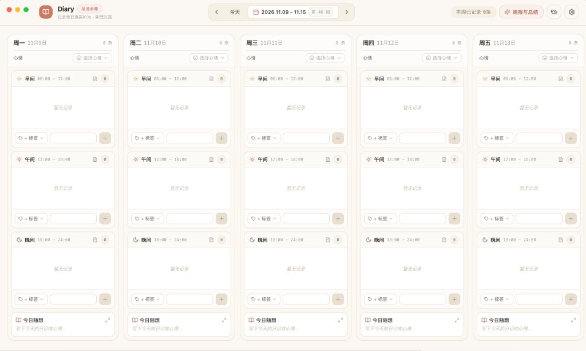

# 📅 Diary — 专为 J 人打造的工作生活足迹手帐与智能周报助手

<p align="center">
  
  
  
  
  
  
  
</p>

---

## 💡 项目初衷：为什么是「已做足迹（Done-Log）」而不是「待办清单（Todo）」？

市面上有无数的 Todo 待办与日历规划工具，但对于许多想要踏实掌控生活节奏的 **J 人（MBTI-Judging）** 来说，往往容易陷入「列了一堆计划、未完成时产生负罪感」的内耗。

**Diary 走了一条完全相反却极度务实的道路：**
- **不做虚无的预设计划**，而是忠实记录你每天早、中、晚**实际上做了什么**。
- **事事有记录，归档有条理，复盘有抓手。**
- 接入 **DeepSeek API**，周末或月末一键生成**直白、客观、项目导向**的极炼周报与月报。

---

## ✨ 核心特性一览

### 1. 📅 7 天周视图横向看板
横向平铺周一至周日整整 7 天，一眼纵览全周节奏。每天垂直划分为三大经典时段：
- 🌅 **早间 (Morning · 06:00 - 12:00)**：清晨状态与专注开局
- ☀️ **午间 (Afternoon · 12:00 - 18:00)**：核心推进与深度攻坚
- 🌙 **晚间 (Evening · 18:00 - 24:00)**：复盘整理、运动健身与生活放松

### 2. 🏷️ 彩色分类与习惯标签
事项不再是杂乱无章的纯文本。每条记录均可绑定色彩分明的分类胶囊标：
- **开箱预置**：`工作`、`学习`、`健身`、`日常`、`休息`
- **高度自定义**：支持随时在标签管理中新建个性化标签、挑选调色盘配色或自定义色值

### 3. 🎭 心情选择与每日随想日记
- **状态与心情记录**：点击心情胶囊唤起精致下拉列表，图文并茂展示 Emoji 与中文状态标签（⚡高效、💪活力、🧘平静、☕专注、🎉愉快、🔥忙碌、😴疲惫、🌧️低落），一键选定或切换当天状态。
- **今日随想日记**：每列底部常驻日记栏，支持快速记下闪念；点击一键放大进入全屏/弹窗**沉浸式专注长文写作模式**，并支持对照今日已完成的足迹进行深度复盘。

### 4. 🤖 DeepSeek 驱动的极简周报/月报
拒绝空话套话，让 AI 成为你的客观复盘秘书：
- 🎯 **核心成果进展**：按标签分类（如工作、学习等），提炼 2~4 条最重要的核心成果与进展。
- 💪 **习惯与成长**：提炼健身频次、学习收获与生活规律。
- 🧘 **节奏洞察**：根据一周的心情分布与日记，输出 1~2 句务实的心理与精力状态反馈。
- 🚀 **下周重点建议**：根据未尽事宜与工作流给出高价值推进建议。
- 📋 **一键复制 Markdown**：格式干净整洁，随时粘贴至周报邮件、工作群或个人知识库。

### 5. 🔒 100% 本地隐私安全承诺
- **数据完全本地化**：所有事项记录、随想与报告均保存在项目本地 SQLite 数据库（`data/diary.db`）中，**绝对不上云**。
- **严格 Git 隔离**：内置强力 `.gitignore`，自动隔离 `data/` 数据库文件与 `.env` 配置文件，开源推送到 GitHub 时绝无隐私泄露之忧。

---

## 🖥️ 应用界面预览

<p align="center">
  
</p>

---

## 🚀 快速上手与运行指南

### 1. 克隆代码与依赖安装
确保本机已安装 Node.js (推荐 v18+ 或更新版本)：
```bash
git clone https://github.com/LIKEASHOT/Dairy.git
cd Dairy
npm install
```

### 2. 配置 DeepSeek API 密钥
复制环境变量模版文件并填入你的 DeepSeek API Key（如暂不使用周报功能可稍后配置）：
```bash
cp .env.example .env
```
在 `.env` 中填入你的 Key：
```env
DEEPSEEK_API_KEY=sk-xxxxxxxxxxxxxxxxxxxxxxxxxxxxxxxx
DEEPSEEK_BASE_URL=https://api.deepseek.com
DEEPSEEK_MODEL=deepseek-chat
```
*(注：`.env` 已被 `.gitignore` 彻底忽略，保证绝不会被 Git 提交)*

### 3. 启动应用
你可以通过以下任一方式启动运行：

- **桌面客户端模式（推荐）**：
  ```bash
  npm start
  ```
  即可启动 Electron 原生桌面窗口，体验原生 macOS 窗口与 Dock 集成。

- **浏览器轻量模式**：
  ```bash
  npm run dev
  ```
  在本地浏览器直接打开 `http://localhost:5173` 进行快速记录与体验。

### 4. 构建打包
打包当前平台的独立桌面客户端安装包：
```bash
npm run pack
# 或生成正式发布包
npm run dist
```

---

## 📂 项目工程目录结构

```
diary/
├── .env.example               # 开源环境变量配置模版
├── .gitignore                  # 严密隐私隔离配置（隔离数据与密钥）
├── data/                      # 本地 SQLite 数据库目录（git 忽略）
│   └── diary.db               # 你的个人手帐 SQLite 数据库
├── backups/                   # 一键导出备份目录（git 忽略）
├── electron/                  # Electron 桌面端主进程
│   ├── main.ts                # 主窗口创建与生命周期调度
│   ├── preload.ts             # 安全类型 IPC 桥接
│   └── services/
│       ├── db.ts              # 本地 SQLite 封装与事务存储
│       └── deepseek.ts        # DeepSeek API 请求与周报引擎
├── src/                       # React 渲染进程（UI 前端）
│   ├── components/
│   │   ├── Navbar.tsx         # 顶部周导航与操作栏
│   │   ├── WeekView.tsx       # 7 天周视图平铺看板
│   │   ├── DayColumn.tsx      # 单天足迹列（心情、时段、随想）
│   │   ├── SlotCard.tsx       # 早中晚已做事项记录卡片（Done-Log）
│   │   ├── DiaryModal.tsx     # 沉浸式深度日记写作弹窗
│   │   ├── ReportDrawer.tsx   # DeepSeek 周报/月报侧边抽屉
│   │   ├── TagManagerModal.tsx# 项目与习惯彩色标签管理
│   │   └── SettingsModal.tsx  # 设置与数据一键导出 (JSON/MD)
│   ├── lib/                   # 工具函数（日期算法、默认标签等）
│   ├── types/                 # TypeScript 强类型定义
│   ├── App.tsx                # 应用核心状态汇聚
│   ├── main.tsx               # 前端入口
│   └── index.css              # 全局样式与 Tailwind
├── package.json
├── tailwind.config.js
├── tsconfig.json
└── vite.config.ts
```

---

## 🛡️ 数据导出与备份

在软件右上角的「⚙ 设置」中，支持一键备份：
- **导出 Markdown (`.md`)**：按日期与时段清晰排版的纯文本手帐，可直接导入 Obsidian、Notion 或 Logseq。
- **导出完整 JSON (`.json`)**：备份所有结构化足迹、标签与历史报告，方便随时在任何设备间冷迁移。

---

## 🤝 开源与贡献

欢迎所有热爱生活、追求条理记录的伙伴一起维护和拓展 Diary！
- 发现 Bug 或有新想法？欢迎提交 [Issues](https://github.com/LIKEASHOT/diary/issues)
- 欢迎提交 [Pull Requests](https://github.com/LIKEASHOT/diary/pulls) 共同完善

## 📄 开源许可证

本项目采用 [MIT 许可证](LICENSE) 开源。
